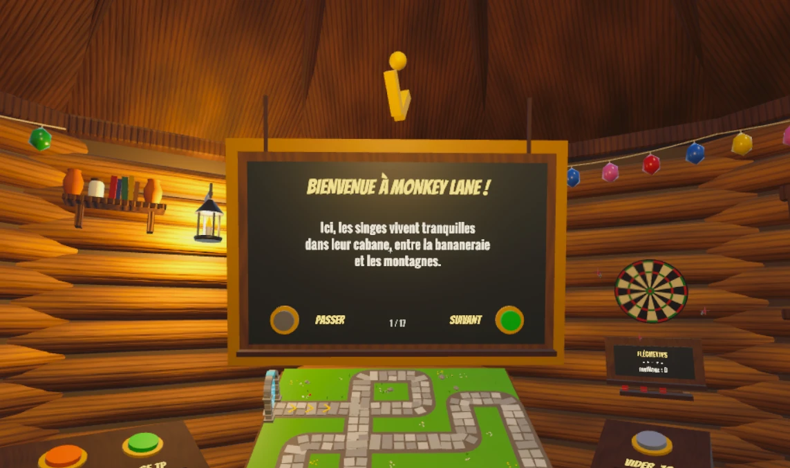
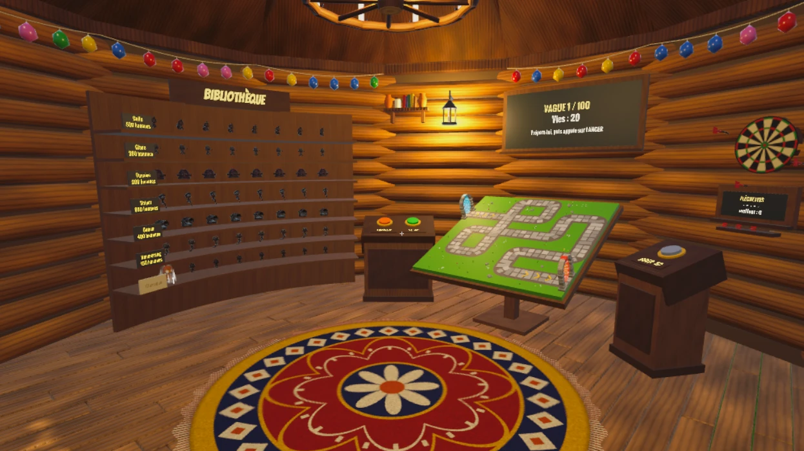
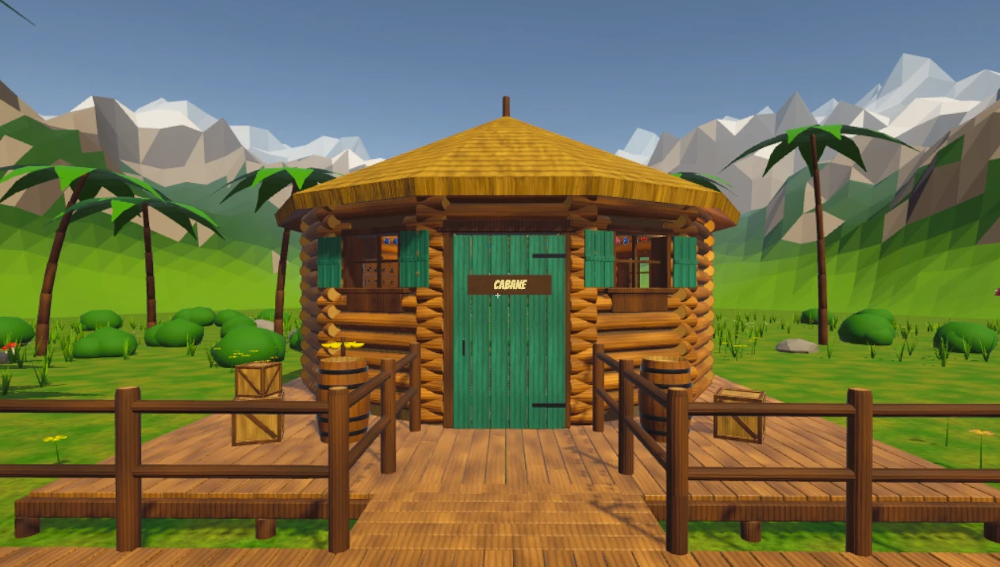
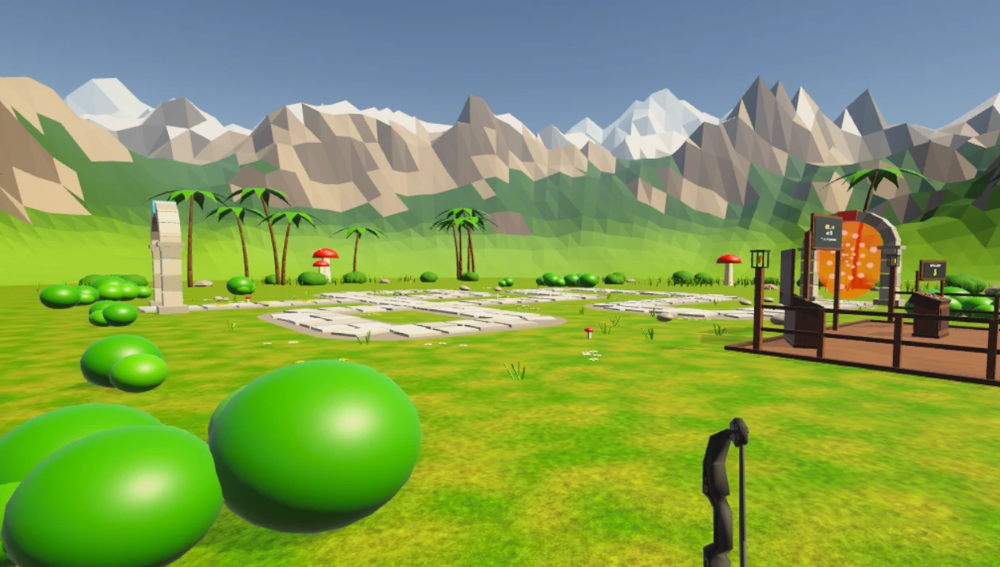
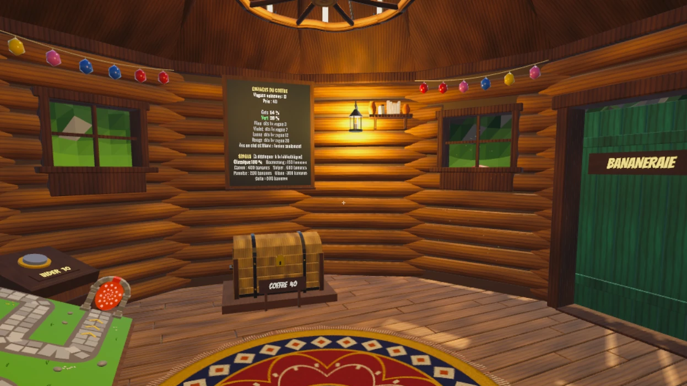
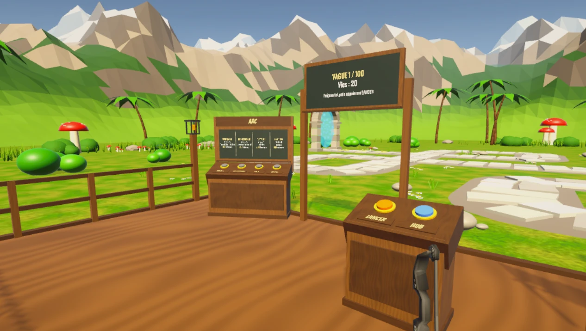
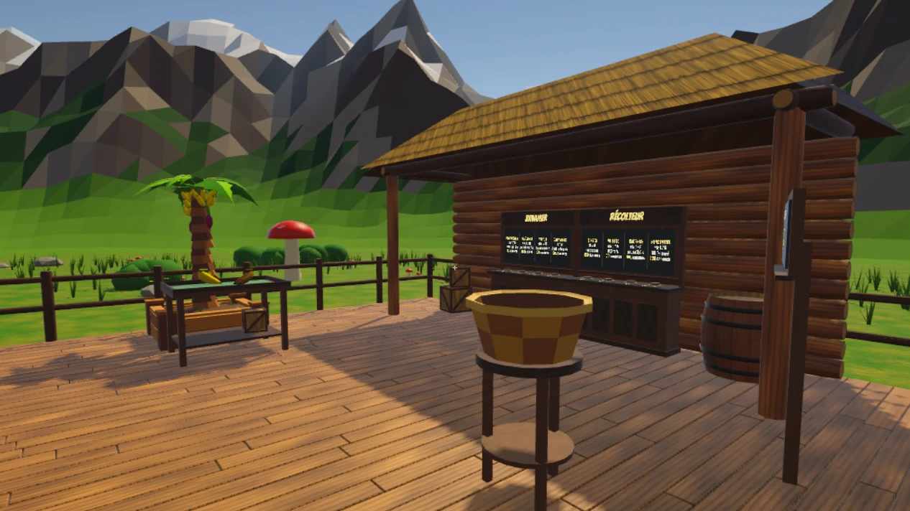
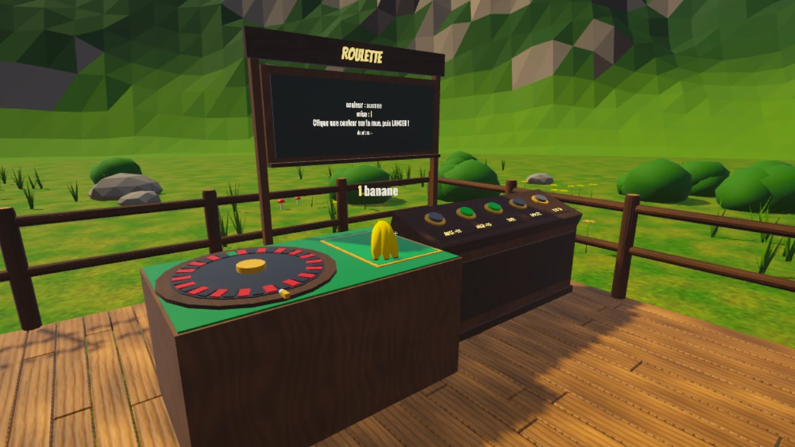

# Bloons VR — Game Design Document

_Un tower defense en réalité virtuelle · Dylan, Maxens et Nicolas · BUT MMI 3, IUT de Béziers (SAÉ 5D.01) · **version finale du 13 nov. 2026**_

## 1. Fiche d'identité

| Élément | Détail |
|---|---|
| **Titre de travail** | Bloons VR (fan-game d'école, à renommer pour une diffusion) |
| **Genre** | Tower defense + tir à l'arc + gestion légère |
| **Support** | Casque VR autonome (Meta Quest), debout, espace de jeu de 2 × 2 m minimum ; mode PC clavier-souris pour le développement |
| **Joueurs** | 1 ; jusqu'à 4 en coop par Internet (bonus : le jeu est complet en solo) |
| **Public** | Joueurs occasionnels dès 10 ans, découvreurs de la VR, fans de Bloons TD |
| **Durée d'une session** | 2 min de tutoriel, puis des parties de 10 à 30 min (une vague dure 30 s à 2 min) |
| **Ton** | Cartoon, coloré, chaleureux, jamais violent (on éclate des ballons) |
| **Moteur** | Unity 6000.6, XR Interaction Toolkit 3.6, OpenXR |

## 2. Pitch
**En une phrase :** un tower defense en VR dans l'univers de Bloons TD : tu es Quincy, tu tires à l'arc sur les ballons, tu poses tes singes à la main sur une maquette, et tu fais tourner ta bananeraie pour payer le tout.

**En un paragraphe :** des vagues de ballons suivent un chemin de dalles vers la cabane des singes. Le joueur passe sans cesse entre deux échelles :
- **géant dans la cabane**, penché sur une maquette vivante de la carte, il prend ses singes dans une bibliothèque, les pose et les fusionne ;
- **à taille réelle sur la carte**, l'arc en main, il défend lui-même le chemin.

Entre deux vagues, il passe la porte de la cabane pour récolter ses bananes avant qu'elles ne pourrissent : elles paient les coffres, les nouveaux singes et les améliorations. L'objectif : tenir 100 vagues jusqu'aux dirigeables rouges, puis aller le plus loin possible en mode infini.

## 3. Le geste et la boucle

### 3.1 Le geste central
**Tirer à l'arc.** L'arc est dans la main gauche. La main droite vient chercher la corde, serre le grip, recule pour tendre, vise et lâche. C'est le geste VR du jeu : impossible à faire aussi bien à la souris.

**Les gestes secondaires :**
- **saisir et poser** un singe sur la maquette (grip, rayon de pose) ;
- **attraper et lancer** une banane dans le panier ;
- **enfoncer** de gros boutons ronds et **pousser** une porte ;
- **lancer** des fléchettes sur une cible (bonus).

### 3.2 La boucle de 30 secondes
> Le joueur **tire à l'arc et place ses singes** pour **arrêter la vague de ballons**, mais **les ballons arrivent plus nombreux et plus solides, et les bananes pourrissent si on ne les ramasse pas**, et il gagne **des bananes, qui achètent des singes, des coffres et des améliorations**.

### 3.3 Les trois boucles imbriquées

| Échelle | Durée | Le joueur… | Il obtient… |
|---|---|---|---|
| **Micro** | 2 à 5 s | bande l'arc, vise, éclate un ballon ; lance une banane | un ballon de moins, une banane vendue |
| **Vague** | 30 s à 2 min | prépare (pose, fusionne, achète), lance la vague, défend | 20 + 10 × n° de vague bananes |
| **Partie** | 10 à 30 min et plus | débloque des types, fusionne vers les raretés hautes, améliore l'arc et la bananeraie | atteindre la vague 100, puis le mode infini |

## 4. Univers et direction artistique

### 4.1 Univers
L'univers de Bloons TD est assumé : des singes, des ballons colorés, un chemin qui serpente. Le joueur incarne **Quincy**, l'archer de la cabane. Il n'y a pas de scénario à embranchements : l'histoire tient en trois tableaux au début du tutoriel (« Bienvenue à Monkey Lane », « Alerte aux Bloons », « Toi, c'est Quincy »).

### 4.2 Les trois lieux

| Lieu | Ce qu'on y voit | Ce qu'on y fait |
|---|---|---|
| **La cabane (hub)** | Cabane ronde en rondins, toit de chaume, lustre en roue de charrette, lanternes, guirlande de ballons, tapis rond à motifs | Poser et fusionner les singes sur la maquette, ouvrir le coffre, lancer les vagues, jouer aux fléchettes |
| **La bananeraie** | Derrière la grande porte : terrasse en planches fermée par une barrière, allée, abri en rondins, 1 à 3 bananiers, panier sur tabouret, roulette | Récolter les bananes, améliorer les arbres, acheter des récolteurs, miser à la roulette |
| **La carte** | Prairie façon Monkey Lane : chemin de dalles qui se croise deux fois, fleurs, champignons, buissons, palmiers, montagnes low-poly, deux portails en pierre | Défendre à l'arc depuis une estrade en bois, améliorer l'arc |

### 4.3 Direction artistique
- **Style :** low-poly coloré et lisible, des formes rondes et des couleurs saturées. Le décor (cabane, bananeraie, paysage, coffre, roulette) est fait maison par scripts Blender (`Blender/cabane.py`, `coffre.py`, `roulette.py`), textures comprises : le bois, le plancher, le tapis ou les points des champignons sont **dessinés par le script**, rien n'est téléchargé.
- **Palette :** bois chaud (cabane, estrade), vert prairie, gris pierre (chemin, portails), or pour l'interface (titres, cadres, flèche du tutoriel), ardoise vert-noir et craie pour les textes.
- **Typographie :** **Bangers** pour les titres (esprit BD), **Oswald Bold** pour les textes. Tout texte est écrit sur un objet du décor.
- **Lumière :** soleil de fin d'après-midi, poussières dorées dans les rayons des fenêtres, flammes qui vacillent dans les lanternes.
- **Codes couleur :**
  - les ballons changent de couleur à chaque couche perdue ;
  - les raretés vont du gris au blanc (gris, vert, bleu, violet, jaune, rouge, arc-en-ciel animé, blanc) ;
  - rouge = interdit, vert = possible, or = action proposée.

### 4.4 Droits
L'univers appartient à Ninja Kiwi. Le projet reste un exercice d'école et un fan-game non commercial, sans logo ni asset officiel. Une candidature aux **Pégases** (catégorie Meilleur jeu étudiant) demanderait de renommer le jeu et de changer l'habillage (singes, ballons, nom), ce qui reste possible : toute la mécanique est indépendante de la marque.

## 5. Type de jeu et références
**« C'est Bloons TD, mais avec ton arc en main et tes singes posés à la main sur une maquette. »**

| Référence | Ce qu'on lui emprunte |
|---|---|
| **Bloons TD 6** | Les codes du tower defense, les types de ballons (couches, rapides, blindés, dirigeables), la carte Monkey Lane |
| **Rush Royale** | La fusion de deux unités identiques, le coffre et ses raretés |
| **Job Simulator** | Saisir, lancer, enfoncer des boutons : tout est physique |
| **In Death, The Lab (Longbow)** | La sensation du tir à l'arc en VR |
| **How to Fish** | La mise posée sur la table, visible (roulette) |
| **Moss** | Le joueur géant penché sur un monde miniature (la maquette) |
| **Plate Up** | En coop, chacun prend un rôle : l'un tire à l'arc, l'autre place les singes, un autre récolte |
| **Gamble With Your Friends** | La borne de blackjack et ses gros boutons |

## 6. Contrôles

| Action | Casque (Meta Quest) | Mode PC |
|---|---|---|
| Se déplacer | Téléportation : stick vers l'avant, viser, relâcher (marche au stick gauche en option, coupée par défaut) | ZQSD |
| Tourner | Snap turn de 45° (stick gauche / droite) | Souris |
| Prendre un singe, une banane | Viser (rayon) ou toucher, puis serrer le grip | Clic maintenu |
| Poser / lancer | Relâcher le grip (le rayon de pose montre où) | Relâcher le clic |
| Appuyer sur un bouton | Le toucher du bout de la manette, ou le viser et appuyer sur la gâchette | Clic |
| Tirer à l'arc | Main droite sur la corde, grip, reculer, lâcher | Clic droit maintenu, puis relâcher |
| Fiche d'un singe | Bouton A en visant le singe | Touche A |
| Ouvrir une porte | La pousser de la main, ou la viser et appuyer | Clic |

## 7. Mécaniques et règles

### 7.1 Les deux temps
- **Préparation (au hub) :** rien n'attaque. On gère les singes, les bananes, le coffre, puis on appuie sur **LANCER**.
- **Attaque :** la vague suit son chemin. On peut rester au hub (la maquette montre la carte en direct, ballons compris) ou aller sur la carte avec **SE TP** pour tirer à l'arc. Le monde qu'on quitte continue de tourner : les bananes tombent pendant qu'on défend.

### 7.2 Les singes
On les prend dans la **bibliothèque**, un meuble courbe avec une ligne par type et une colonne par rareté. On les pose sur la maquette avec un rayon de pose : le fantôme est vert si c'est possible, rouge sinon, et un cercle montre la portée.

**Règles de pose :**
- jamais sur le chemin ;
- à 0,95 m au moins d'un autre singe ;
- deux singes côte à côte dans les boucles.

On peut reprendre un singe posé. **VIDER** (10 bananes) range tout le plateau.

| Type | Effet | Portée | Tir toutes les… | Perce | Cibles | Déblocage |
|---|---|---|---|---|---|---|
| **Classique** | Tire sur le ballon le plus avancé | 6 m | 1 s | 1 | 1 | offert |
| **Boomerang** | Touche 2 ballons par lancer | 6 m | 1 s | 1 | 2 | 150 |
| **Punaise** | Touche 4 ballons proches (protège un virage) | 2,5 m | 0,7 s | 1 | 4 | 200 |
| **Glace** | Ralentit tous les ballons à portée (onde de froid) | 6 m | 1,5 s | 0 | tous | 300 |
| **Canon** | Explosion autour de la cible | 5 m | 1,5 s | 1 | zone | 400 |
| **Colle** | Colle un ballon : très lent pendant 3 s | 6 m | 1 s | 0 | 1 | 500 |
| **Sniper** | Tire sur toute la carte, gros dégâts, voit les camouflés | 100 m | 2 s | 3 | 1 | 600 |

**Progression par rareté :**
- **Portée :** +0,3 m par rareté (+0,15 m pour la Punaise).
- **Camouflés :** le Sniper les voit toujours, les autres singes à partir de la rareté Violet.
- **Cadence :** +20 % par rareté.
- **Perce :** +1 couche toutes les 2 raretés.

Les singes posés sont **animés** : ils se tournent vers leur cible, font un geste propre à leur type et lancent de vrais projectiles 3D.

### 7.3 Fusion et raretés
**Deux singes identiques (même type, même rareté) fusionnent en un singe de la rareté suivante.** On pose le second sur le premier. Un fantôme doré montre le résultat, avec un halo qui pulse.

Les 8 raretés : gris → vert → bleu → violet → jaune → rouge → arc-en-ciel → blanc. Les deux dernières ne s'obtiennent que par fusion.

### 7.4 Le coffre
Le coffre se paie en bananes : **40 + 15 par vague vaincue**. Il s'ouvre en roulette et donne **un singe**. Son type est tiré parmi les types débloqués. Sa rareté dépend de la vague :

| Rareté | Poids de base | Possible dès la vague |
|---|---|---|
| Gris | 50 | 0 |
| Vert | 28 | 0 |
| Bleu | 14 | 3 |
| Violet | 6 | 7 |
| Jaune | 2 | 12 |
| Rouge | 0,9 | 20 |

Les chances sont affichées sur un tableau au mur à côté du coffre (transparence).

### 7.5 Quincy et l'arc
- **Tir physique :** la tension dépend du recul de la main. Il y a 0,3 s entre deux tirs, pour ne pas « spammer ».
- **L'arc n'existe que sur la carte :** au hub, on a les mains libres.

Le **pupitre ARC**, sur l'estrade, vend des améliorations qui se cumulent :

| Amélioration | Effet | Paliers et prix |
|---|---|---|
| **Perforante** | Couches percées par ballon touché : 1 → 6 | 100, 200, 400, 700, 1 200 |
| **Transperçante** | Ballons traversés par flèche : 1 → 8 | 150, 300, 500, 800, 1 300 |
| **Tir triple** | 2 flèches de plus, à ±8° | 500 |
| **Explosion** | Onde au contact : 3 à 8 ballons, rayon 1 à 3 m | 150, 300, 500, 800, 1 300 |

### 7.6 Les ballons

| Sorte | Taille | Vitesse | Particularité |
|---|---|---|---|
| **Normal** | 0,9 | ×1 | Perd une couche par point de perce ; sa couleur change à chaque couche |
| **Rapide** | 0,65 | ×1,7 | Petit et vif |
| **Blindé** | 1 | ×0,8 | Moitié moins de dégâts, ne peut pas être ralenti |
| **Cœur** | 0,9 | ×1 | Regagne une couche toutes les 2 s |
| **Camouflé** (normal ou rapide) | — | — | Kaki, avec des taches sombres : **seuls le Sniper et les singes Violet et plus le voient** ; les flèches de Quincy le touchent toujours |
| **Boss (MOAB)** | 1,8 | ×0,6 | Très solide, hélice qui tourne ; **en éclatant, lâche 4 ballons normaux** |
| **Dirigeable rouge (BFB)** | 2,2 | ×0,35 | Boss final, blindé, insensible au ralentissement ; **en éclatant, lâche 2 boss** |

**Les boss se divisent**, comme dans Bloons TD : les petits ballons repartent de l'endroit où le boss a éclaté, un peu espacés sur la piste, avec une onde de choc. Leurs couches suivent la solidité du boss (un boss à 17 couches lâche des normaux à 3 couches, jusqu'à 6 couches au plus ; le dirigeable lâche des boss au quart de ses couches). Éclater un boss n'est donc pas la fin du danger.

Un ballon qui atteint la sortie retire **autant de vies que ses couches restantes**. On a 20 vies par vague, et elles repartent au maximum à chaque vague. Perdre une vague ne fait pas tout recommencer : on la rejoue, singes et bananes gardés. **Éclater un ballon ne rapporte rien** : seule la vague finie paie, pour pousser à défendre proprement.

### 7.7 Les 100 vagues
Elles sont calculées par une formule (`WaveBook.Make`) qui monte sans à-coups, avec des paliers façon Bloons. **Durcies le 23 oct.** (retour de Dylan : trop faciles) : plus de ballons, plus de couches, plus serrés, chaque sorte arrive plus tôt.

| Vague | Nouveauté | Exemple de composition |
|---|---|---|
| 1 | Ballons normaux seulement | 10 normaux à 1 couche |
| 2 | Un 2e groupe plus solide | 11 × 1 couche + 5 × 2 couches |
| 3 | **Rapides** | 12 + 6 normaux, 3 rapides |
| 6 | **Blindés** | 15 + 7 normaux, 5 rapides, 2 blindés |
| 10 | **Cœurs** (une vague sur deux) et **camouflés** (à chaque vague) | 19 + 8 normaux, 8 rapides, 4 blindés, 2 cœurs, 2 camouflés |
| 12 | **Premier boss**, puis un toutes les 4 vagues | … + 1 boss à 22 couches |
| 20 | **Rapides camouflés** | 28 + 11 normaux, 16 rapides, 11 blindés, 4 cœurs, 5 + 1 camouflés, 1 boss |
| 25 | **Dirigeable rouge** | … + 1 dirigeable à 117 couches |
| 50 | 2 dirigeables ; un boss à chaque vague dès la 40 | 55 + 21 normaux, 40 rapides, 31 blindés, 12 cœurs, 15 + 8 camouflés, 3 boss, 2 dirigeables |
| 75 | 3 dirigeables | … |
| **100** | **Finale : 4 dirigeables rouges → victoire** | 100 + 38 normaux, 80 rapides, 64 blindés, 24 cœurs, 32 + 21 camouflés, 6 boss, 4 dirigeables à 230 couches |
| 101 et + | Mode infini, la formule continue | |

**Les vagues spéciales sont annoncées** (celles qui ont un boss ou un dirigeable) :
- **pendant la préparation**, le tableau prévient : « VAGUE DE BOSS ! » ou « DIRIGEABLE ROUGE EN APPROCHE ! » ;
- **au lancement**, trois coups de cloche ;
- **quand le boss entre sur la piste**, un cor grave, et le tableau affiche « LE BOSS ARRIVE ! ».

Les sons s'entendent du hub comme de la carte : on sait qu'il faut y retourner. Les manettes battent deux fois, comme un cœur.

### 7.8 La bananeraie

**Les bananiers :**
- une banane tombe toutes les 8 s au départ ;
- elle vaut 5 ;
- elle pourrit en 15 s : elle brunit, se ratatine, sent mauvais, puis disparaît ;
- **tenue en main**, par le joueur ou un singe, elle ne pourrit pas ;
- **banane dorée** : 1 sur 25 (4 %) tombe toute dorée et brillante, avec une aura légère. Elle vaut **10 fois plus** et pourrit **2 fois moins vite**. C'est la petite surprise qui fait courir au pied de l'arbre (réglages sur le bananier : `chanceDoree`, `multiplicateurDore`, `pourritureDoree`).

**Le comptoir BANANIER**, sous l'abri, propose des améliorations communes à tous les arbres. Le prix est multiplié par 1,6 à chaque niveau :

| Amélioration | Effet par niveau | 1er prix |
|---|---|---|
| Production | −0,6 s entre deux bananes (jusqu'à 1,5 s) | 60 |
| Fraîcheur | +3 s avant de pourrir (jusqu'à 60 s) | 40 |
| Valeur | +3 bananes par banane | 80 |
| +1 arbre | 2e bananier, puis 3e | 500, puis 1 500 |

**Le comptoir RÉCOLTEUR :**
- Il vend des **singes récolteurs** : 150 le premier, puis 300, etc.
- Ils ramassent les bananes de tous les arbres et les lancent dans le panier. Ils ratent leur lancer 1 fois sur 4 : ils boudent, puis vont la rechercher. Ils font un dunk 1 fois sur 5.
- On les améliore en vitesse, cadence et rendement, sur 5 niveaux chacune (100 × 1,6^niveau).

### 7.9 Les bonus du hub
- **Roulette (casino), dans la bananeraie, ouverte à la vague 5 (barrières avant, comme le blackjack) :**
  - roue européenne de 37 cases ;
  - on clique une case pour choisir sa couleur (rouge, noir ou vert) ;
  - on mise par 10, ou TOUT ;
  - le rouge et le noir paient 1 contre 1, le vert (le zéro) 35 contre 1 ;
  - des bananes posées sur le tapis montrent la mise.

- **Borne de blackjack, à côté de la roulette** (style « Gamble With Your Friends ») : une partie en solo contre un singe croupier à chapeau, sous une arche noire :
  - on tape sa mise sur un terminal (pavé 0-9, 000, C ; mises rapides MIN, 1/4, 1/2, MAX de la bourse ; min 5) ;
  - 4 gros boutons sur une console penchée : DOUBLER, RESTER, CARTE, JOUER ;
  - au-dessus de 21, la main est perdue ; le croupier tire jusqu'à 16 et reste à 17 ; gagné ×2, blackjack (21 en 2 cartes) ×2,5, égalité = mise rendue.
- **En coop** (« gamble with your friends ») : une seule roulette pour tous (l'hôte tire, tout le monde voit le même lancer) ; au blackjack, chacun joue sa partie à sa borne. La bourse est commune (#171).

- **Cible de fléchettes, au mur de la cabane :** 3 fléchettes par manche, 5 à 50 points selon l'anneau, meilleur score affiché. C'est une pause ludique sans enjeu.

### 7.10 Économie

**Une seule monnaie, la banane.**
- **Sources :** les bananes vendues au panier, et la récompense de vague (20 + 10 × n°, soit 30 à la vague 1 et 1 020 à la vague 100).
- **Dépenses :** coffre, déblocage des types, améliorations (arc, bananiers, récolteurs), arbres, VIDER, roulette.

**Repères d'équilibrage :**
- 1 bananier sans amélioration ≈ 37 bananes par minute si tout est ramassé ;
- 1er coffre ≈ vague 1 + 2 bananes ;
- Boomerang vers la vague 3, Sniper vers la vague 10.

On démarre avec **0 banane et aucun singe** : la vague 1 se gagne à l'arc, puis le tutoriel offre le premier singe. Une caisse affiche le total au hub, dans la bananeraie et sur la carte : on voit ses bananes partout.

### 7.11 Autour de la partie
- **Menu principal** : une scène vivante (singes animés, ballons), avec CONTINUER, NOUVELLE PARTIE, OPTIONS et COOP. On y revient en jeu par le menu pause.
- **Sauvegarde automatique** sur le casque : à chaque vague gagnée, toutes les 30 s et quand on enlève le casque. On reprend où on en était. Pas de méta-progression : une nouvelle partie repart de zéro.
- **Armoire à trophées** (8 coupes) : 4 pour les vagues (10, 50, 100, 200) et 4 pour les bananes gagnées (1 000, 5 000, 15 000, 50 000). Bronze, argent, or, platine : plus la coupe est rare, plus elle est grande et ornée. Une plaque gravée dit où on en est.
- **Classement** : local (gardé sur le casque) et en ligne (bonus : un serveur PHP + MySQL sur l'espace web de l'IUT). Sans réseau, le local marche toujours.
- **Météo des vagues de boss** : nuages au lancement, puis pluie, brume et tonnerre quand le boss entre, ciel dégagé à la fin. Il ne pleut pas dans la cabane, on y entend la pluie, étouffée.

### 7.12 Coop par Internet (bonus)
- **Jusqu'à 4 joueurs** (casque ou PC). L'hôte ouvre la partie depuis le menu pause avec un mot de passe ; les autres la rejoignent depuis le menu avec le code de la partie.
- **Partagé :** la bourse, la bibliothèque, les singes posés, les vagues et les ballons, les flèches, la bananeraie (mêmes bananes, mêmes singes récolteurs, même comptoir), le coffre, les fléchettes, le singe tenu en main, la roulette.
- **Chacun chez soi :** l'arc et ses améliorations, le blackjack, le tutoriel, la sauvegarde.
- **Technique :** Netcode for GameObjects (la solution réseau d'Unity) et Unity Relay (un serveur relais qui passe aussi le Wi-Fi de l'IUT). L'hôte fait tourner la partie ; les autres lui envoient leurs demandes.
- **Pourquoi c'est hors consigne :** le support de la SAÉ met le multijoueur en ligne dans les NON. On l'assume comme un bonus : il ne change rien au jeu solo, et il a été fait après que le solo était jouable du début à la fin. **Pas encore testé à deux au complet** (#204).

## 8. Tutoriel intégré (niveau 1)
**Principe :**
- une consigne à la fois, écrite sur des **tableaux du décor** (suspendu dans la cabane, sur poteaux dans la bananeraie et sur la carte), jamais collée au visage ;
- une **flèche dorée** rebondit et pulse au-dessus de ce qu'il faut toucher, avec un **rayon doré** qui monte vers le ciel (visible de loin) ; quand la cible est loin, une **flèche au sol**, aux pieds du joueur, montre la direction ;
- les consignes de l'arc changent selon le mode (casque ou PC) ;
- les grands moments ont leur **annonce** qui surgit devant le joueur, posée dans le décor à 2 m (pas collée au visage) : « PRÊT AU COMBAT ! », « VICTOIRE ! », « BIEN POSÉ ! », « FUSION RÉUSSIE ! »… ou « DOMMAGE ! » ; une action refusée affiche « SUIS LA FLÈCHE DORÉE ! » (le tableau est peut-être derrière lui) ;
- le ton des textes est celui de Bloons : joyeux, direct, une action claire par tableau, le geste ou le bouton en MAJUSCULES ;
- chaque étape arrive avec son titre qui surgit, sa consigne écrite lettre par lettre et une gerbe de petits ballons ;
- le cadre du tableau pulse en or pour attirer l'œil.

**Garde-fous :**
- **Seule l'action demandée est permise.** Toute autre action est refusée : le tableau tremble et son cadre rougit.
- **Vague 1 stricte :** un seul ballon qui passe et c'est raté, il faut la relancer. On ne félicite pas un joueur qui n'a pas tiré.

**Les 23 étapes :**

| # | Étape | Lieu | Ce que fait le joueur | Passe à la suite quand… |
|---|---|---|---|---|
| 1-3 | L'univers et le genre | Cabane | Lit : la cabane, les ballons qui arrivent, ce qu'est un tower defense (éclater les ballons avant la sortie, avec l'arc et des singes posés) | SUIVANT |
| 4 | En route | Cabane | Appuie sur SE TP | il arrive sur la carte |
| 5 | Ton arc | Carte | Lit où est l'arc (main gauche au casque, bas de l'écran au PC) | SUIVANT |
| 6 | Échauffement | Carte | Éclate 3 ballons d'entraînement qui flottent au-dessus du chemin, au milieu de la carte (le tableau compte « 1 / 3 BALLONS ») ; une flèche trop peu tendue tombe et le tableau dit « TENDS PLUS FORT ! » | 3 ballons éclatés |
| 7 | Vague 1 | Carte | Appuie sur LANCER | la vague part |
| 8 | Pas un seul ne passe | Carte | Éclate les 8 ballons, sans en laisser passer. Raté : « DOMMAGE ! » surgit, et le tableau propose **REFAIRE** (la vague repart) ou **CONTINUER** (on passe à la suite, le premier singe est quand même offert) | vague gagnée, ou CONTINUER |
| 9 | Améliore ton arc | Carte | Lit : les boutons de l'arc (flèches qui percent, tir triple…) | SUIVANT |
| 10 | Bravo | Carte | Reçoit son premier singe, appuie sur HUB | il est au hub |
| 11 | Tes bananes | Cabane | Lit : les bananes sont l'argent, la caisse les compte | SUIVANT |
| 12 | La bibliothèque | Cabane | Lit : types en lignes, raretés en colonnes, plus rare = plus fort | SUIVANT |
| 13 | De nouveaux singes | Cabane | Lit : les plaques débloquent un type, qui pourra sortir du coffre ; chacun a son pouvoir | SUIVANT |
| 14 | Ton premier singe | Cabane | Le prend (la flèche montre sa case) | il le tient |
| 15 | Pose-le | Cabane | Le pose sur le plateau | il est posé |
| 16 | Les bananes | Bananeraie | Passe la porte, lance une banane dans le panier | il a gagné des bananes |
| 17 | Le comptoir | Bananeraie | Lit à quoi servent PRODUCTION, FRAÎCHEUR et VALEUR | SUIVANT |
| 18 | Les récolteurs | Bananeraie | Lit : ils ramassent pour lui, on améliore leur vitesse et leur part | SUIVANT |
| 19 | Le coffre | Cabane | Ouvre le coffre, **offert** ; il donne un Classique gris | coffre ouvert |
| 20 | La fusion | Cabane | Pose le nouveau singe **sur** le premier (la pose à côté est refusée) | un singe vert existe |
| 21-22 | Trophées, fléchettes | Cabane | Lit (la flèche montre l'armoire, puis la cible) | SUIVANT |
| 23 | À toi de jouer | Cabane | Lance la vague 2 | la vague part : fin |

**Le casino, plus tard :** la roulette n'est plus dans le tutoriel. La roulette et la borne de blackjack sont **fermées par des barrières** rouges et blanches, avec une pancarte « CASINO FERMÉ · ouvre à la vague 5 (2 / 5) » ; ses boutons et sa roue refusent. À la **vague 5**, les barrières s'enfoncent dans le sol et deux étapes de plus apparaissent sur les tableaux : « LE CASINO OUVRE ! » (la flèche l'y amène), puis « LA ROULETTE » (comment jouer). Elles ne bloquent rien. Pourquoi : au début, on apprend la boucle (arc, singes, bananes) sans parier ses premières bananes, et le casino devient une récompense.

**PASSER** saute tout (le premier singe est quand même offert). Le tutoriel ne se lance pas en bac à sable (mode de développement).

## 9. Level design

### 9.1 La carte
- **Taille :** 24 × 24 m (8 cases de 3 m), à taille réelle.
- **Le chemin :** 2,2 m de large, 13 lignes droites aux coins arrondis, qui **se croisent deux fois**. Les ballons passent donc deux fois aux croisements, qui sont les meilleures places pour les singes.
- **Les portails :** l'entrée est au bord ouest, la sortie au sud-est. Deux portails en pierre avec un voile lumineux et un tourbillon montrent d'où viennent les ballons et où ils vont. Des chevrons dorés indiquent le sens.
- **L'estrade :** le joueur arrive au sud, sur une estrade en bois bordée d'une rambarde et de lanternes. On y trouve :
  - le pupitre LANCER / HUB ;
  - le tableau de la vague ;
  - la caisse ;
  - le pupitre ARC ;
  - le tableau du tutoriel.
- **Téléportation :** limitée à la carte, plus 4 m autour. Les arbres et buissons commencent au-delà, pour qu'on ne se pose jamais dedans.

### 9.2 La cabane
Tout est posé **en cercle de 2,8 m autour du joueur**, qui se tient sur le tapis central. Un ou deux pas suffisent pour tout atteindre.

| Angle | Élément |
|---|---|
| 0° (devant) | Le plateau incliné de 25° (maquette de 1,6 m), le tableau de la vague au mur |
| −41° | Pupitre LANCER / SE TP |
| +37° | Pupitre VIDER |
| −82° (gauche) | La bibliothèque (7 types × 8 raretés) |
| +97° (droite) | Le coffre et le tableau de ses chances |
| −136° | La caisse (bananes) |
| 30° (mur) | La cible de fléchettes |
| 180° (derrière) | La grande porte vers la bananeraie |

### 9.3 La bananeraie
- **La terrasse :** 14 × 8,4 m, fermée par une barrière. On y arrive par une allée depuis la porte.
- **À gauche,** trois places de bananier, chacune avec son étal.
- **À droite,** le panier et la caisse.
- **Au fond, sous l'abri,** les comptoirs BANANIER et RÉCOLTEUR.
- **Dans la partie agrandie, à droite,** la roulette.
- **Téléportation :** possible partout, sauf sur les meubles.

## 10. Interface et feedback

### 10.1 Interface diégétique
Il n'y a **aucun texte à l'écran**. Tout est écrit sur un objet du décor, à 1 ou 2 m du joueur :
- **les ardoises** affichent la vague, les vies, l'état, la caisse, les chances du coffre, la roulette, les fléchettes et le tutoriel ;
- **les enseignes** (BIBLIOTHÈQUE, ARC, BANANIER, RÉCOLTEUR, ROULETTE) disent à quoi sert chaque meuble ;
- **les plaques de prix** sont dorées si on peut payer, grises sinon ;
- **les panneaux de porte** indiquent où elle mène : BANANERAIE depuis la cabane, CABANE depuis dehors.

### 10.2 Affordances
- **Gros bouton rond** = il s'enfonce.
- **Poignée de l'arc** = la main.
- **Le rayon devient coloré** sur ce qui est utilisable.
- **Un bouton grossit** quand on le vise.
- **La porte s'entrouvre et frémit** quand on la vise.
- **Banane :** jaune = mûre, brune qui sent = pourrie, dorée et brillante, avec une aura = rare, elle vaut 10 fois plus.
- **Fantôme de pose :** vert = possible, rouge = interdit, doré = fusion.

### 10.3 Feedback de chaque action

| Action | Image | Vibration | Son |
|---|---|---|---|
| Viser un bouton | Le bouton grossit | « tic » léger | — |
| Appuyer | Le bouton s'enfonce | Moyenne | Clic de bouton |
| Action refusée (tutoriel, achat trop cher) | Le tableau tremble, cadre rouge | Très faible | Achat refusé |
| Bander l'arc, tirer | La corde se tend, traînée dorée | Monte avec la tension, coup sec au tir | Corde qui se tend, tir |
| Flèche qui touche un ballon | Le ballon change de couleur, puis disparaît | Tic sec dans la main de l'arc | Éclatement (3 au plus par image, pour éviter la cacophonie) |
| Boss qui éclate | Onde de choc, les petits ballons en sortent | Grosse secousse, deux mains | Éclatement |
| Ballon qui passe (vies perdues) | Les vies baissent sur le tableau (rouges sous 5) | Grondement, deux mains | Vie perdue |
| Vague spéciale | « VAGUE DE BOSS ! », puis « LE BOSS ARRIVE ! », orage | Deux battements de cœur | Cloches, puis cor grave (boss ou dirigeable), musique de boss, tonnerre |
| Vague gagnée / perdue / victoire finale | Message sur le tableau | Trois tics qui montent / un long et sourd | Jingle gagné / perdu / victoire |
| Attraper une banane | Elle suit la main | Douce et brève | — |
| Vendre une banane | « +5 » qui flotte, la caisse saute | Deux tics | Vente |
| Vendre une banane dorée | « +50 » qui flotte | Trois tics qui montent | Vente |
| Poser un singe / fusion | Fantôme vert / doré, halo | Moyenne / forte | Pose / fusion |
| Coffre | Le couvercle s'ouvre, la roulette tourne, le singe sort en grossissant | — | Ouverture, singe obtenu, fermeture |
| Amélioration de l'arc | La plaque se met à jour | — | Amélioration (et un son à part au niveau max) |
| Téléportation, porte | Voile noir fondu | — | Téléportation |

_Chaque action a sa vibration, avec un motif différent pour la reconnaître sans regarder (`Haptics`). Les sons et les musiques (ambiance, vague, boss) sont arrivés en semaine 2 (Maxens, `Resources/Sons`)._

## 11. Pourquoi la VR
- **Les mains :**
  - bander l'arc, viser, lâcher : la précision vient du geste, pas d'un clic ;
  - poser un singe à la main sur la maquette, lancer une banane dans le panier, pousser une porte.
- **Le regard :** surveiller le chemin des ballons, repérer la banane qui pourrit, suivre la bille de la roulette.
- **La présence et l'échelle :**
  - **géant** penché sur une maquette vivante, où les ballons circulent en miniature ;
  - puis **à taille réelle** au milieu des mêmes ballons, sous un dirigeable de plusieurs mètres.
- **Le corps dans l'espace :** on passe la porte pour récolter, on se retourne vers la bibliothèque, on se penche sur le plateau.

**Test de l'écran :** à la souris, poser des tours marcherait aussi bien. **Ce qui justifie la VR, c'est l'arc, le changement d'échelle et le double jeu « gérer la base tout en défendant ».**

## 12. Pourquoi c'est un bon jeu
- **Il se prend en main sans doc :** le tutoriel joue le niveau 1, et chaque consigne est montrée par la flèche, dans le décor.
- **Il s'appuie sur des codes connus :** tower defense, fusion à la Rush Royale, coffre à raretés, couleurs des ballons de Bloons.
- **Il hérite de la culture du jeu vidéo :** paliers de difficulté, boss, mode infini, la mise du casino, le « dunk » des singes récolteurs.
- **Il crée des décisions :**
  - défendre à l'arc ou récolter ses bananes avant qu'elles pourrissent ;
  - fusionner tout de suite ou garder deux singes ;
  - miser ses bananes ou les économiser.

## 13. Périmètre (MoSCoW) : bilan final

_✅ = dans le jeu · ✂️ = coupé · 🧪 = codé, pas encore testé au complet. « Dans le jeu » ne veut pas dire « validé au casque » : voir 16.3._

| DOIT | DEVRAIT | POURRAIT | NE FERA PAS |
|---|---|---|---|
| 1 carte, 1 chemin, 100 vagues progressives + finale ✅ | Fusion et raretés ✅ | Plus de types de singes (7) ✅ | Plusieurs cartes |
| Quincy à l'arc, tir physique ✅ | Bananes qui pourrissent, singes récolteurs ✅ | Améliorations de l'arc (4) ✅ | Méta-progression entre les parties |
| Singes posés à la main ✅ | Coffre et sa roulette ✅ | Ballons cœur et blindé ✅, boss qui se divisent ✅ | Gacha complet, achats réels |
| Bananes → panier → déblocages ✅ | Décor soigné (cabane, montagnes, lumière) ✅ | Bananes dorées ✅, 2e et 3e bananiers ✅ | Scénario, monde ouvert |
| Tutoriel intégré (niveau 1, 17 étapes) ✅ | Animations des singes ✅ | Roulette, blackjack, fléchettes ✅ | Déplacement continu **par défaut** (en option seulement) |
| Confort : téléportation, snap turn, UI dans le décor ✅ ; 72 fps : réglages faits, **mesure au casque à faire** | Sons, musiques ✅ et une vibration par action ✅ | Météo des vagues de boss (nuages, pluie, brume, tonnerre) ✅ ; nuit ✂️ | |
| Victoire / défaite claires (tableau, jingle, vibration) ✅ | Vagues spéciales annoncées ✅, ballons camouflés ✅ | Trophées ✅, classement local ✅ et en ligne ✅ | |
| | Sauvegarde automatique ✅ | Menu principal vivant ✅ | |
| | Équilibrage : vagues durcies après les tests du 23 oct. ✅ | Coop par Internet jusqu'à 4 🧪 (#204) ; casino à plusieurs 🧪 | |
| | | Combo de vagues parfaites ✂️, bombes à lancer ✂️, pluie de flèches ✂️ (#132, #134, #135, coupés le 10 nov.) | |

**Ce qui a bougé depuis la v1 du GDD (9 oct.) :**
- **Sauvegarde** : « pas de sauvegarde » est devenu DEVRAIT (21 oct.). Sans elle, chaque lancement créait une nouvelle partie au classement. La méta-progression reste interdite.
- **Multijoueur** : il était dans NE FERA PAS. Le coop est passé en POURRAIT (22 oct.), en bonus assumé (voir 7.12).
- **Semaine 3** : surtout des corrections, de l'optimisation et des finitions (voir 15.2). Une exception, assumée : le coop a été complété (bananeraie, coffre, fléchettes et singe tenu en main partagés, Maxens, 10-11 nov.), car en coop on ne voyait pas ce que faisait l'autre joueur.

## 14. Confort (non négociable)
- **Déplacement :** téléportation par défaut, limitée aux zones de jeu. Pas de saut. La marche au stick existe en option (menu OPTIONS) pour ceux qui la supportent : coupée par défaut. Un **voile noir fondu** couvre chaque téléportation et chaque passage de porte.
- **Rotation :** snap turn par crans de 45°.
- **Caméra :** jamais bougée à la place du joueur, pas d'accélération, pas de secousse, horizon toujours droit.
- **Interface :** dans le décor, à 1-2 m. Pas de texte collé au visage.
- **Portée :** tout est à portée de bras (cercle de 2,8 m). Les singes et les bananes s'attrapent de loin, jusqu'à 6 m, sans ramasser au sol en boucle.
- **Sessions :** vagues courtes, pause naturelle entre deux vagues.
- **Technique :** 72 fps visés (compteur au poignet en build de test), 1 unité Unity = 1 m. Au casque : fovéation dynamique, pas de post-traitement (voir 15.2). **La mesure des 72 fps au casque reste à faire** (#35).

## 15. Technique

### 15.1 Architecture
- **Deux scènes chargées ensemble :** `Hub` (cabane et bananeraie) et `Labyrinthe` (la carte). Il n'y a qu'un seul joueur, dans `Hub` ; changer de niveau, c'est le déplacer. Le monde qu'on quitte continue de tourner.
- **Scènes générées par code :** le menu `SAE > Générer le prototype` (`PrototypeGenerator`) reconstruit les deux scènes à partir des scripts et des modèles Blender. Il n'y a jamais de conflit de scène entre membres de l'équipe.
- **Données centralisées :**
  - `MonkeyData` : statistiques et prix des singes ;
  - `WaveBook` : les 100 vagues ;
  - `BowUpgrades` : l'arc ;
  - `Economy` / `GameState` : bananes, inventaire, singes posés.
- **Interactions :** une interface `IPressable` pour tous les boutons, qu'on touche (`HandPress`), qu'on vise (`RayPress`) ou qu'on clique (`DesktopPlayer`). Le tutoriel filtre ces appuis (`Tutorial.TryPress`).
- **Tutoriel :** une machine à états (`Tutorial`), des tableaux qui s'abonnent à ses événements (`TutorialBoard`), une flèche (`TutorialRunner`) et des cibles posées dans les scènes (`TutorialTarget`).
- **Modèles 3D :** générés par scripts Python dans Blender (`Blender/cabane.py`, `coffre.py`, `roulette.py`) et exportés en `.glb`. Ils sont régénérables à tout moment.
- **Persistance et réseau :** `SaveGame` (sauvegarde sur le casque), `Leaderboard` (classement local + API PHP/MySQL), `Coop` / `CoopGame` / `CoopOrchard` (Netcode for GameObjects + Unity Relay : l'hôte décide, les invités demandent par RPC, l'état partagé est en `NetworkVariable` / `NetworkList`).
- **En chiffres :** 158 scripts C#, environ 19 200 lignes.

### 15.2 Optimisation (Quest)
Chaque optimisation est notée dans [opti.md](opti.md) (problème, ce qui a été fait, avant / après, ce qu'on perd). Les principales :
- **Rendu au casque :** le bon asset URP mobile (le profil Quest pointait sur celui par défaut), pas de post-traitement, fovéation dynamique, distance de vue à 250 m, build sans mode développement.
- **Moins d'objets créés en jeu :** pools pour les ballons, les projectiles, les sons, les ondes ; sons et pools préparés au chargement (plus d'à-coup au premier pop ou au premier boss).
- **CPU :** ciblage des singes sans LINQ, `Rigidbody` cinématiques sur les ballons, `Update` inutiles coupés, 60 singes posés au plus, au plus 3 sons d'éclatement par image.
- **Dessin :** matériaux partagés, décor de la carte fusionné par couleur (`MeshBatch`), objets fixes « static » et occlusion, ombres coupées sur les ballons et les projectiles, aura des singes en un maillage au lieu de 100 systèmes de particules, Mesh LOD automatique, textures limitées à 1024 px.
- **Modèles allégés en S3 :** cabane **97 737 → 68 333 triangles** (rondins, fenêtres, sol en une dalle texturée, tapis, lustre, champignons, palmiers), paysage de la carte **62 043 → 52 791**. Les objets les plus lourds restants : buissons (14 400) et montagnes (13 056).
- **Ce qu'on n'a pas fait :** fusionner les maillages des singes riggés (trop risqué sans test à 4 jours du rendu), la mesure des fps au casque (#35).

### 15.3 Mode PC
Un mode clavier-souris permet de développer et de tester sans casque. Il sert aussi à la **démo à plat** de l'oral.

## 16. Production

### 16.1 Planning

| Semaine | Objectif | Jalon |
|---|---|---|
| S1 · 5-9 oct. | Prouver : le geste marche au casque, le GDD tient | GDD v1 + prototype jouable (ven. 9 oct.) |
| S2 · 19-23 oct. | Construire : jouable du début à la fin | Test par un autre groupe (ven. 23 oct.) |
| S3 · 9-13 nov. | Finir : plus de nouvelle fonctionnalité ; tuto, confort, fluidité, build stable | Rendu et oral (ven. 13 nov.) |

**Ce qu'a été la semaine 3 :** fusion des optimisations (PR #188), modèles allégés, coop complété (bananeraie, coffre, fléchettes), cubes de test retirés, scintillements corrigés, ménage du suivi GitHub (fonctions coupées proprement, jalons S1 et S2 fermés).

### 16.2 Organisation
- **Suivi :**
  - tableau GitHub Project (À faire / En cours / En relecture / Fait) ;
  - une issue par tâche, avec des labels de priorité (DOIT / DEVRAIT / POURRAIT) et de zone ;
  - un jalon par semaine.
- **Git :**
  - GitHub flow : `main` toujours stable ;
  - une branche courte par tâche ;
  - une Pull Request par tâche.
- **Journaux :** un journal d'équipe et un journal par personne, avec le tableau des usages de l'IA (outil, pour quoi, gardé / jeté). Les prompts sont gardés dans `prompts/`.
- **Répartition finale :**
  - **Dylan :** hub et carte, singes (pose, fusion, maquette en direct), 100 vagues, tutoriel, menu, sauvegarde, classement, météo, coop (réseau), modèles Blender, optimisation, suivi GitHub et fusion des branches ;
  - **Maxens :** bananeraie (bananiers, pourriture, récolteurs), coffre, sons et musiques, roulette lancée à la main, boss qui se divisent, coop de la bananeraie, du coffre et des fléchettes ;
  - **Nicolas :** premier coffre (raretés, roulette), arc refait avec ses 4 améliorations, première roulette, armoire à trophées.
- **En chiffres (12 nov.) :** 136 issues, 65 pull requests, 384 commits sur `main` (Dylan 317, Maxens 62, Nicolas 4 : le travail de Nicolas est surtout arrivé par fusion de ses branches).

### 16.3 Tests
- **Au casque :** tester chaque jour, et faire un build casque chaque vendredi.
- **Test du silence :** on donne le casque sans rien dire, on note les blocages, on corrige le jeu (S2, avec un autre groupe).
- **Ce que les tests ont changé :** le 23 oct., les testeurs ne jouaient pas vraiment au tower defense (trop facile) : vagues durcies, ballons camouflés, Punaise à 2,5 m. Au casque (8 oct.) : arc à 0,3 s entre deux tirs, plus de téléportation dans les arbres, fléchettes enfin attrapables.
- **Encore à vérifier avant le rendu :**
  - les 72 fps au casque, sur la carte en fin de partie (#35) ;
  - le coop à deux au complet (#204) ;
  - les modèles allégés de la S3, vus dans Unity et au casque.

### 16.4 Risques

| Risque | Parade |
|---|---|
| Chute de fps aux vagues hautes (centaines de ballons) | Mesurer sur Quest, limiter les ballons simultanés, fusionner les maillages |
| Équilibrage des 100 vagues | Tout est dans `WaveBook.Make` et `MonkeyData` : on règle en quelques minutes |
| Jeu muet | ✅ réglé en S2 : sons et musiques (Maxens) |
| Coop pas testé à deux au complet | Le solo ne dépend pas du coop ; test #204 avant la démo, sinon on ne le montre pas |
| Branches qui s'empilent | Ménage du 9-10 nov., une PR relue par tâche |
| Droits de l'univers Bloons | Habillage remplaçable pour une diffusion (Pégases) |

## 17. Oral du 13 novembre
Le plan détaillé, le texte de chaque partie, le parcours de démo et les questions probables sont dans [ORAL.md](ORAL.md) ; le support est le site [oral/index.html](oral/index.html).
1. **Le jeu** : pitch, geste, boucle, références.
2. **Pourquoi la VR** : l'arc, l'échelle, le corps dans l'espace ; le test de l'écran.
3. **Démo** : le tutoriel (2 premières minutes) puis une vague de boss, au casque ou en mode PC.
4. **Équipe et organisation** : qui a fait quoi, GitHub, journaux.
5. **Technique et optimisation**, puis **l'IA** (journaux, gardé / jeté).
6. **Bilan** : ce qui a été dur, ce qu'on retient.
